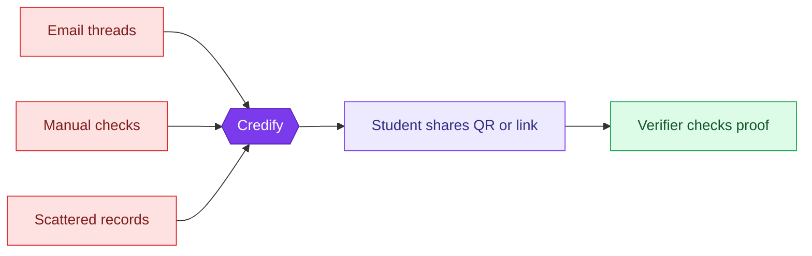
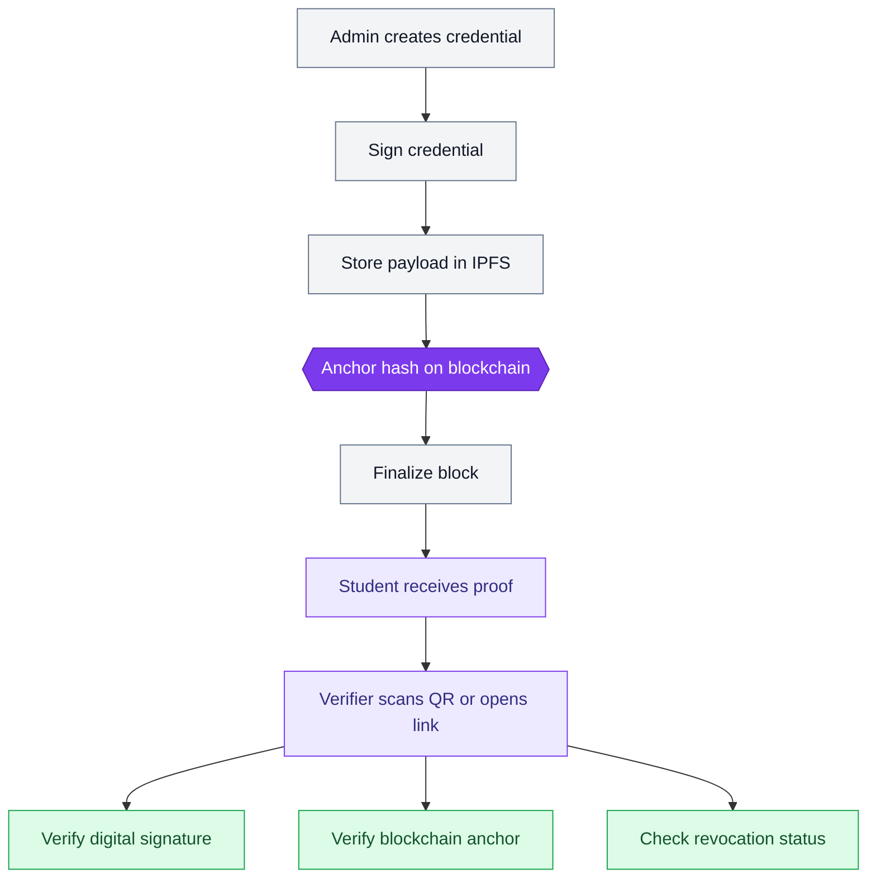
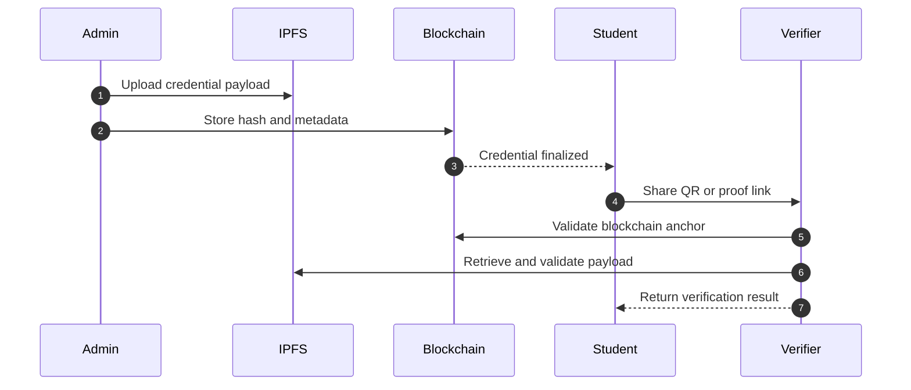

 <div align="center">

  <picture>
    <source media="(prefers-color-scheme: dark)" srcset="https://raw.githubusercontent.com/udaycodespace/credify/main/assets/credify-logo-white.svg">
    
  </picture>

  **Is that degree real? Stop emailing the registrar. Check the proof..**

  A permissioned blockchain system for issuing, sharing, and independently verifying academic credentials.

  
  
  
  
  
  
  
  
</div>

---

## The result

**A credential can be verified without emailing the institution that issued it.**

Credify makes that possible through cryptographic signatures, blockchain-backed hash records, and IPFS storage.

An institution issues a credential. A student shares its QR code or verification link. A verifier checks its authenticity, blockchain record, and revocation status.

No unnecessary email chains. No relying on a PDF alone. Just verifiable proof.

## The problem isn't the certificate. It's proving it's real.

Academic certificates are commonly shared as PDFs. But a PDF can be copied, edited, or presented without a reliable way to establish its origin.

Verification often involves:

- Emailing the issuing institution.
- Waiting for manual confirmation.
- Checking records across disconnected systems.
- Trying to establish whether a document has been altered.

**Credify is not another document storage system. It is a verification layer built around the credential itself.**

### From manual verification to verifiable proof



<div align="center">

<table align="center">
  <thead>
    <tr>
      <th>Challenge</th>
      <th>Traditional approach</th>
      <th>Credify approach</th>
    </tr>
  </thead>
  <tbody>
    <tr>
      <td>Fake certificates</td>
      <td>Manual document inspection</td>
      <td>Digital signatures and blockchain hashes</td>
    </tr>
    <tr>
      <td>Slow verification</td>
      <td>Institutional email follow-ups</td>
      <td>Independent proof verification</td>
    </tr>
    <tr>
      <td>Scattered records</td>
      <td>Disconnected systems</td>
      <td>Structured credential flow</td>
    </tr>
    <tr>
      <td>Trust gaps</td>
      <td>Unclear document origin</td>
      <td>Cryptographic proof and permissions</td>
    </tr>
  </tbody>
</table>

</div>

## How Credify works

**Issue. Sign. Store. Anchor. Verify.**

The process starts with an authorized institution administrator and ends with an independent verification result.

### 1. The credential lifecycle



### 2. How the components communicate



### 3. What gets verified?

| Verification check | Purpose |
|---|---|
| Digital signature | Confirms the credential's signature is valid. |
| Blockchain anchor | Checks that the credential hash matches the anchored record. |
| Revocation status | Determines whether the credential has been revoked. |

## What's inside

| Component | Responsibility |
|---|---|
| Issuance | Creates and signs academic credentials. |
| Storage | Stores credential payloads using IPFS. |
| Blockchain | Anchors hashes and maintains the ledger. |
| Verification | Checks signatures, anchors, and revocation status. |
| Access control | Protects privileged issuer actions through OTP-based access. |

## Features

Not another PDF upload portal. Not another manual verification workflow.

**A structured credential verification system.**

| Feature | What it provides |
|---|---|
| Permissioned network | Controlled participation by approved validator nodes. |
| Finalized blocks | A consistent ledger with tamper-evident records. |
| Independent verification | Proof checking without relying on manual institutional responses. |
| Selective disclosure | Allows holders to share only the information needed. |
| Cryptographic proof | RSA signatures and SHA-256 hashes. |
| QR and link sharing | Convenient access to credential verification. |
| Revocation checks | Verification of credential revocation status. |
| OTP-based access | Additional protection for privileged issuer actions. |
| Role-based access | Separate permissions for admins, students, and verifiers. |

## Who is it for?

| User | Value |
|---|---|
| Students | A portable credential proof that can be shared easily. |
| Academic institutions | A structured issuance and verification workflow. |
| Verifiers | A direct way to check credential authenticity. |
| Recruiters | A faster alternative to email-based credential confirmation. |

## Technology stack

| Layer | Technologies | Purpose |
|---|---|---|
| Backend | Python, Flask | Application server and business logic. |
| Security | RSA, SHA-256 | Digital signatures and credential hashing. |
| Storage | IPFS | Distributed credential payload storage. |
| Database | SQLite, PostgreSQL | Application data persistence. |
| Blockchain | Permissioned network | Credential hash anchoring and validation. |
| Deployment | Docker, Docker Compose | Application and validator deployment. |
| Automation | GitHub Actions | Repository workflow automation. |

## Run Credify locally

Want to explore the implementation? Start with Docker or run the application locally.

### Option 1: Docker

```bash
docker pull udaycodespace/credify:latest

docker run -d -p 5000:5000 udaycodespace/credify:latest
```

### Option 2: Local setup

```bash
git clone https://github.com/udaycodespace/credify.git

cd credify

python -m venv venv
```

**Windows**

```bash
venv\Scripts\activate
```

**Linux / macOS**

```bash
source venv/bin/activate
```

Install dependencies and start the application:

```bash
pip install -r requirements.txt

cp .env.example .env

python main.py
```

### Option 3: Start validator nodes

```bash
docker-compose up -d
```

| Validator | Local endpoint |
|---|---|
| Validator 1 | [http://localhost:5001](http://localhost:5001) |
| Validator 2 | [http://localhost:5002](http://localhost:5002) |
| Validator 3 | [http://localhost:5003](http://localhost:5003) |

## Security model

Credify uses multiple controls to protect credential issuance and verification.

| Security control | Purpose |
|---|---|
| OTP access | Protects privileged issuer actions. |
| RSA signatures | Provides cryptographic authenticity checks. |
| SHA-256 hashing | Detects changes to credential payloads. |
| Role boundaries | Separates admin, student, and verifier permissions. |
| Finalized ledger | Provides a tamper-evident verification record. |

## What's next?

The current implementation provides the foundation. Future development can extend it through:

| Planned enhancement | Potential benefit |
|---|---|
| PBFT-style consensus | A stronger validator consensus model. |
| DID support | Improved decentralized identity interoperability. |
| Zero-knowledge proofs | More privacy-preserving credential verification. |
| Governance controls | Better validator administration. |
| Audit dashboards | Improved monitoring and traceability. |

## Why Credify?

Want credentials to be easier to issue, harder to fake, and faster to verify?

**Build the proof into the credential workflow itself.**

That's the idea behind Credify.

---

<div align="center">

  **Kept practical. Focused on trust.**

  Made by [udaycodespace](https://github.com/udaycodespace)

</div>

---

Copyright (c) 2026 Uday. All rights reserved.
