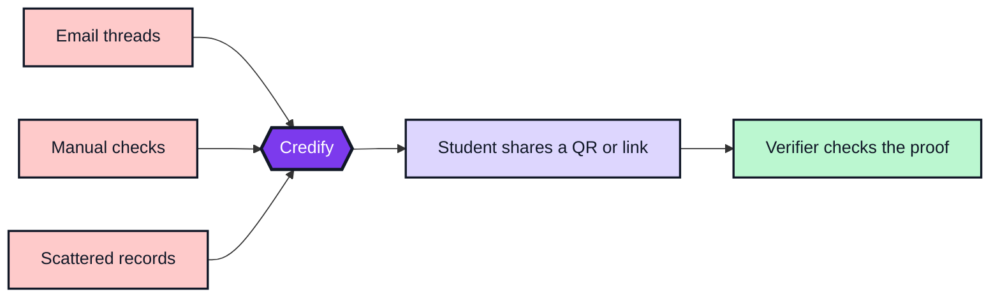
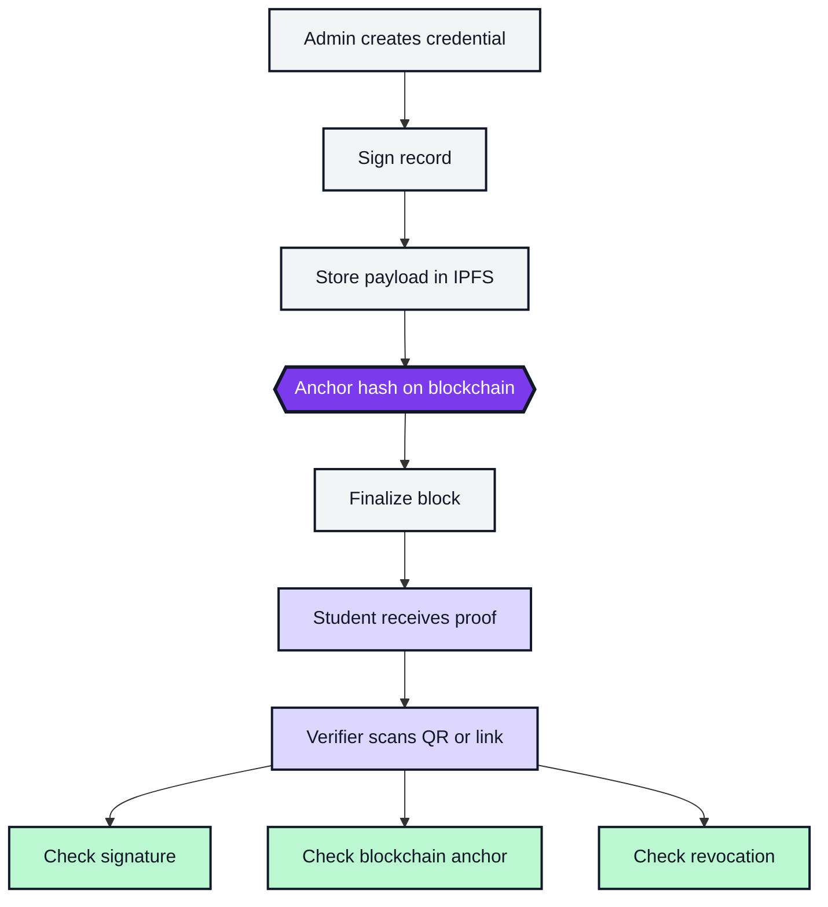
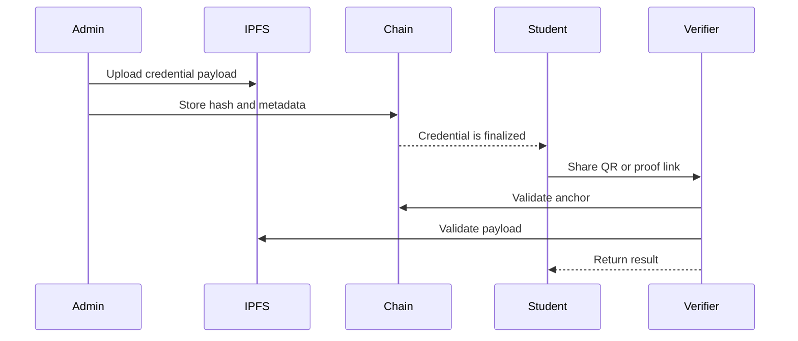

<div align="center">

<picture>
  <source media="(prefers-color-scheme: dark)" srcset="assets/credify-logo-white.svg">
  
</picture>

# Credify

Is that degree real? Stop emailing the registrar. Check the proof.


[](https://github.com/udaycodespace)

</div>

## About

Credify is a permissioned blockchain for academic credential verification. It is built for institutions that issue credentials, students who hold them, and verifiers who need to trust them.

An institution signs a credential and anchors its hash on the chain. The student shares a QR code or a link. The verifier checks the proof directly, so tampering is obvious and nobody has to wait for an email reply.

I built it solo to make credentials easier to issue, harder to fake, and faster to verify.

## The problem

Academic certificates travel as PDFs, and a PDF can be copied or edited. Checking one usually means an email thread, a manual check, and a wait. The records themselves sit in different systems.

Credify keeps the whole flow in one place and gives the verifier something concrete to check.



| Problem | What usually happens | What Credify does |
|:-:|:-|:-|
| Fake certificates | PDFs get copied or edited. | Signs records and anchors them on the chain. |
| Slow verification | Staff have to respond manually. | Lets verifiers check the proof directly. |
| Scattered records | Data lives across different systems. | Keeps the record flow structured. |
| Trust gaps | There is no clear way to confirm where a record came from. | Uses permissions, hashes and signatures. |

## How it works

An admin creates and signs a credential. The payload goes to IPFS and its hash is anchored on the blockchain. Once the block is finalized, the student receives the proof. A verifier scans the QR code or opens the link and runs three checks.





## What's inside

| Part | What it handles |
|:-:|:-|
|  | Creates and signs credentials. |
|  | Stores payloads through IPFS. |
|  | Anchors hashes and keeps the ledger consistent. |
|  | Checks the signature, the anchor and the revocation status. |
|  | Uses OTP-based privileged access for issuer actions. |

## Features

| Feature | How it works |
|:-:|:-|
| Permissioned network | Validation stays controlled, and only approved nodes take part. |
| Finalized blocks | Once a block is finalized, tampering with it is obvious. |
| Independent verification | A verifier checks the proof without asking the institution, so there is less manual follow-up. |
| Selective disclosure | The holder shares only what is needed. |
| Cryptographic proof | RSA signatures and SHA-256 hashes give the verifier something concrete to check. |
| QR or link sharing | The student shares one QR code or proof link, and the verifier opens it. |
| Revocation check | Verification includes the credential's revocation status. |
| OTP for issuer actions | Privileged actions need a one-time code. |
| Role boundaries | Admin, student and verifier each get their own access. |

## Who it helps

| If you are... | Credify gives you... |
|:-:|:-|
| A student | A portable credential proof you can share quickly. |
| An institution | A cleaner issuance and verification flow. |
| A verifier | A direct way to confirm authenticity. |
| A recruiter | A faster check than email-based validation. |

## Tech stack

| Layer | Choice | What it does here |
|:-|:-:|:-|
| Backend |   | The application server. SQLAlchemy handles the database layer. |
| Security |   | RSA signs records. SHA-256 hashes them so any change shows up. |
| Storage |    | IPFS holds credential payloads. SQLite and PostgreSQL are used for database storage. |
| Deployment |  | One image to run the app, and Docker Compose for the validator nodes. |
| Automation |  | Workflows that run on the repo. |

## Quick start

### Docker

```bash
docker pull udaycodespace/credify:latest
docker run -d -p 5000:5000 udaycodespace/credify:latest
```

### Local setup

```bash
git clone https://github.com/udaycodespace/credify.git
cd credify
python -m venv venv

# Windows
venv\Scripts\activate

# Linux or macOS
source venv/bin/activate

pip install -r requirements.txt
cp .env.example .env
python main.py
```

### Validator nodes

```bash
docker-compose up -d
```

| Node | Endpoint |
|:-:|:-|
| Validator 1 | http://localhost:5001 |
| Validator 2 | http://localhost:5002 |
| Validator 3 | http://localhost:5003 |

## Security

| Control | Purpose |
|:-:|:-|
| OTP access | Protects issuer actions. |
| RSA signatures | Proves a record is authentic. |
| SHA-256 hashing | Detects tampering. |
| Role boundaries | Separates admin, student and verifier. |
| Finalized ledger | Makes verification easier to trust. |

## Roadmap

| Next step | What it adds |
|:-:|:-|
| PBFT-style consensus | A stronger validation model. |
| DID support | Better identity interoperability. |
| ZK proofs | More privacy for sensitive data. |
| Governance controls | Cleaner validator management. |
| Audit dashboards | Easier monitoring and traceability. |

## License

Copyright (c) 2026 Uday. All rights reserved.

<div align="center">

Built solo. Kept practical. Focused on trust, not hype.

Made by [udaycodespace](https://github.com/udaycodespace)

</div>
